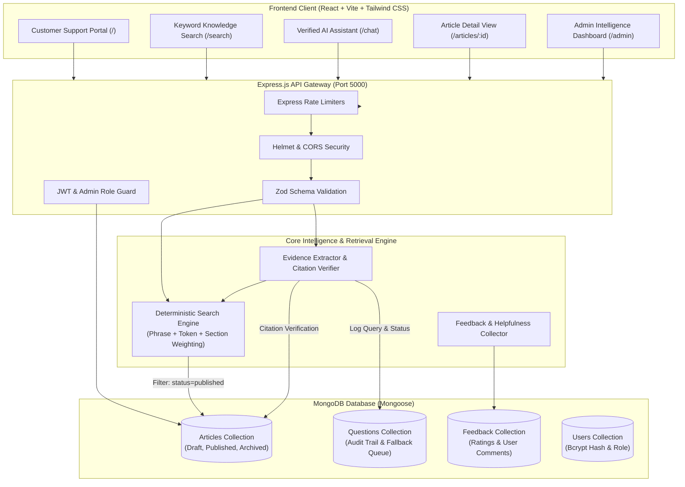

# SupportSense AI — Verified Customer Support Knowledge System

> **Trustworthy Answers Over Unverified AI Responses.**  
> A production-minded, high-precision customer support knowledge engine that pairs deterministic keyword search, section-level extractive evidence grounding, verifiable source citations, and a comprehensive administrator intelligence portal.

---

## 1. Project Overview

Generic LLM chatbots frequently hallucinate return policies, make up warranty terms, invent nonexistent discount codes, and fabricate troubleshooting instructions. In high-stakes customer support, unverified AI answers damage customer trust, increase support escalation costs, and introduce legal compliance liabilities.

**SupportSense AI** solves this problem by strictly adhering to a **grounded-first principle**:
- **Deterministic Keyword Search**: Transparent multi-field relevance scoring across titles, section headings, tags, and content.
- **Strict Evidence Grounding**: The system extracts actionable procedures strictly from approved, published knowledge-base articles.
- **Verifiable Citations**: Every answer provides direct database citations with article titles, section references, and direct links.
- **Safe Fallback**: When reliable evidence is absent, ambiguous, or below the calibrated threshold, the system triggers a safe fallback instead of guessing, automatically queuing the unanswered inquiry for administrative review.
- **Full Admin Lifecycle**: Knowledge base administrators can create, edit, categorize, publish, and archive documentation, while monitoring query resolution metrics and customer feedback.

---

## 2. Architecture Diagram



---

## 3. Technology Stack

### Frontend
- **Framework**: React 18 with Vite
- **Styling**: Tailwind CSS (custom purple-and-white SaaS visual identity)
- **Icons**: Lucide React
- **Routing**: React Router DOM v6
- **HTTP Client**: Axios with request/response interceptors

### Backend
- **Runtime**: Node.js (v20+ / v24+)
- **Web Framework**: Express.js
- **Database**: MongoDB with Mongoose ODM (with auto-fallback to embedded in-memory MongoDB for zero-setup execution)
- **Authentication**: JSON Web Tokens (JWT) & bcryptjs (salt rounds 10)
- **Validation**: Zod schema validation
- **Security**: Helmet headers, custom CORS whitelist, strict IP rate limiters
- **Configuration**: dotenv

### Testing & Evaluation
- **Test Runner**: Node.js built-in test runner (`node --test`)
- **Integration Testing**: Supertest
- **Benchmark Suite**: Custom 12-query evaluation harness calculating Top-1 retrieval accuracy, citation validity, and fallback precision.

---

## 4. Project Structure

```text
chatbot.AI/
├── client/                     # Frontend React + Vite application
│   ├── src/
│   │   ├── components/         # Reusable UI components (Navbar, Footer, AnswerCard, ChatAssistant, FeedbackModal)
│   │   ├── context/            # AuthContext & Session management
│   │   ├── layouts/            # CustomerLayout & AdminLayout (with sidebar)
│   │   ├── pages/              # Customer & Admin pages
│   │   │   ├── admin/          # Admin Dashboard, Articles, Article Editor, Questions, Unanswered, Feedback
│   │   │   ├── AdminLoginPage.jsx
│   │   │   ├── ArticleDetailPage.jsx
│   │   │   ├── ChatPage.jsx
│   │   │   ├── HomePage.jsx
│   │   │   └── SearchPage.jsx
│   │   ├── services/           # Axios API client functions
│   │   ├── index.css           # Tailwind custom styles
│   │   └── main.jsx            # React root mount
│   ├── index.html
│   ├── package.json
│   ├── tailwind.config.js
│   └── vite.config.js
├── server/                     # Backend Express.js application
│   ├── src/
│   │   ├── config/             # Environment validation & DB connection manager
│   │   ├── controllers/        # Article, Chat, Feedback, Admin, and Auth controllers
│   │   ├── middleware/         # JWT Auth, Admin authorization, Zod validation, Error handler
│   │   ├── models/             # Mongoose schemas: Article, User, Question, Feedback
│   │   ├── routes/             # Express API routes
│   │   ├── seed/               # 20+ sample support articles & admin user seed script
│   │   ├── services/           # Deterministic search engine & grounded chat service
│   │   ├── utils/              # Text slugification and normalization
│   │   ├── validators/         # Zod schemas for all endpoints
│   │   └── app.js              # Express app assembly & static build serving
│   ├── tests/                  # Automated test suite & evaluation benchmark
│   │   ├── api.test.js         # 14 comprehensive Supertest API tests
│   │   ├── evaluate.js         # Benchmark evaluation runner
│   │   └── evaluationDataset.js# 12 standardized test queries (in-domain & out-of-scope)
│   ├── .env.example
│   ├── package.json
│   └── server.js               # Entry point with DB connect, auto-seed, & graceful shutdown
├── .env.example                # Root environment sample
├── .gitignore
├── package.json                # Root convenience scripts
└── README.md
```

---

## 5. Prerequisites

- **Node.js**: Version `20.x` or `24.x` installed (`node -v`)
- **npm**: Version `9.x` or `11.x` installed (`npm -v`)
- **MongoDB**: A running local MongoDB instance (`mongodb://127.0.0.1:27017`) or MongoDB Atlas URI.  
  *(Note: If MongoDB is not running locally, SupportSense AI automatically detects this and falls back to an embedded in-memory MongoDB instance so you can test immediately without any database setup!)*

---

## 6. Environment Setup

Copy `.env.example` to `server/.env`:

```bash
# In the server directory:
cp .env.example .env
```

Default configuration variables:

```ini
PORT=5000
NODE_ENV=development
MONGODB_URI=mongodb://127.0.0.1:27017/supportsense
JWT_SECRET=supportsense_dev_super_secret_jwt_key_2026_change_in_production
JWT_EXPIRES_IN=7d
ADMIN_EMAIL=admin@supportsense.ai
ADMIN_PASSWORD=AdminPass123!
MIN_SEARCH_SCORE=15
CORS_ORIGIN=http://localhost:5173
USE_IN_MEMORY_DB=false
```

---

## 7. Installation & Seeding

### 1. Install Dependencies
Run from the workspace root or inside each directory:

```bash
# Server dependencies:
cd server
npm install

# Client dependencies:
cd ../client
npm install
```

### 2. Seed Sample Knowledge Base & Admin Account
Run the idempotent seed script:

```bash
cd server
npm run seed
```

This seeds:
- Initial administrator: `admin@supportsense.ai` (Password: `AdminPass123!`)
- 20 comprehensive published support articles across 6 major support categories:
  1. *Account Support* (Profile updating, email changes, official support contacts)
  2. *Login and Security* (Password resets, 2FA setup, lockout troubleshooting)
  3. *Orders and Delivery* (Order tracking, cancellations, missing packages)
  4. *Payments and Billing* (Invoice PDF downloads, payment methods, failed charges)
  5. *Returns and Refunds* (RMA labels, refund status, 30-day demo eligibility policy)
  6. *Product Troubleshooting* (IoT Wi-Fi pairing, OTA firmware updates, LED error codes)
- 2 internal draft & archived articles to verify search exclusion filters.

---

## 8. Running the Application

### Option A: One-Command Development Launcher (Recommended)
From the workspace root, start both the backend API and the Vite frontend client simultaneously with a single command:

```bash
npm run dev
# Starts backend server on http://localhost:5000 and Vite frontend on http://localhost:5173
```

### Option B: Run in Separate Terminals

**Terminal 1 (Backend Server on Port 5000):**
```bash
npm run dev:server
# Or: cd server && npm start
```

**Terminal 2 (Frontend Client on Port 5173):**
```bash
npm run dev:client
# Or: cd client && npm run dev
```

### Option C: Single-Port Production Mode
Build the client and let the Express server serve the production bundle directly:

```bash
cd client
npm run build
cd ../server
npm start
# Open http://localhost:5000 in your browser!
```

---

## 9. API Endpoint Reference

### Public Customer Endpoints

| Method | Endpoint | Description |
| :--- | :--- | :--- |
| `GET` | `/api/health` | Health check, service status, uptime, and database connection state |
| `GET` | `/api/articles` | List published articles with category/product filtering and pagination |
| `GET` | `/api/articles/:id` | Retrieve an approved published article by ID or slug |
| `GET` | `/api/search?q=...` | Deterministic keyword search across titles, headings, tags, and content |
| `POST` | `/api/chat` | Submit question to verified grounding engine; returns answer + citations |
| `POST` | `/api/feedback` | Submit helpful / not-helpful feedback with optional comment |

### Admin Authentication & Management

| Method | Endpoint | Authorization | Description |
| :--- | :--- | :--- | :--- |
| `POST` | `/api/admin/login` | Public (Rate-limited) | Admin login; returns JWT token and user profile |
| `GET` | `/api/admin/me` | Admin Bearer Token | Verify current admin session |
| `GET` | `/api/admin/dashboard` | Admin Bearer Token | Live analytics (articles, questions, feedback, fallbacks) |
| `GET` | `/api/admin/articles` | Admin Bearer Token | Search and list articles (all statuses: draft, published, archived) |
| `POST` | `/api/admin/articles` | Admin Bearer Token | Create a new article with dynamic sections |
| `GET` | `/api/admin/articles/:id` | Admin Bearer Token | Get article details regardless of status |
| `PATCH` | `/api/admin/articles/:id` | Admin Bearer Token | Edit article title, category, product, tags, or sections |
| `PATCH` | `/api/admin/articles/:id/publish`| Admin Bearer Token | 1-click publish (immediately activates in public search) |
| `PATCH` | `/api/admin/articles/:id/archive`| Admin Bearer Token | 1-click archive (immediately excludes from search/chat) |
| `GET` | `/api/admin/questions` | Admin Bearer Token | Query audit logs with matched citations and timestamps |
| `GET` | `/api/admin/unanswered` | Admin Bearer Token | Unanswered inquiries queue requiring documentation triage |
| `GET` | `/api/admin/feedback` | Admin Bearer Token | Detailed customer feedback ratings and qualitative comments |

---

## 10. Sample Requests & Responses

### 1. Grounded Chat Query (Verified Answer)

**Request:**
```http
POST /api/chat HTTP/1.1
Host: localhost:5000
Content-Type: application/json

{
  "question": "How do I reset my password?"
}
```

**Response (`200 OK`):**
```json
{
  "success": true,
  "answer": "Open the login page, select \"Forgot Password\", enter your registered email address, and click \"Send Reset Link\". Follow the instructions sent to your registered email within 15 minutes.",
  "answered": true,
  "sources": [
    {
      "articleId": "6ae33d10a6c5c8748f362e60",
      "title": "How to Reset Your Password",
      "section": "Reset Password via Login Screen",
      "url": "/api/articles/6ae33d10a6c5c8748f362e60"
    }
  ],
  "questionId": "6ae33d10a6c5c8748f362eab"
}
```

### 2. Out-of-Scope Query (Safe Fallback)

**Request:**
```http
POST /api/chat HTTP/1.1
Host: localhost:5000
Content-Type: application/json

{
  "question": "How do I bake sourdough bread with 70% hydration?"
}
```

**Response (`200 OK`):**
```json
{
  "success": true,
  "answer": "I couldn't find an approved article that reliably answers this question. Please contact customer support for assistance.",
  "answered": false,
  "sources": [],
  "questionId": "6ae33d10a6c5c8748f362ef0"
}
```

### 3. Customer Feedback Submission

**Request:**
```http
POST /api/feedback HTTP/1.1
Host: localhost:5000
Content-Type: application/json

{
  "questionId": "6ae33d10a6c5c8748f362eab",
  "rating": "helpful",
  "comment": "The step-by-step instructions worked immediately!"
}
```

**Response (`201 Created`):**
```json
{
  "success": true,
  "message": "Feedback submitted successfully",
  "feedback": {
    "id": "6ae33d10a6c5c8748f362ff1",
    "questionId": "6ae33d10a6c5c8748f362eab",
    "rating": "helpful",
    "comment": "The step-by-step instructions worked immediately!",
    "createdAt": "2026-10-29T12:35:00.000Z"
  }
}
```

---

## 11. Automated Testing & Benchmark Evaluation

### Run Test Suite
Executes 14 unit and integration tests covering health check, keyword search, status filtering, chat citations, safe fallbacks, input validation, feedback recording, and admin security boundaries:

```bash
cd server
npm test
```

### Run Benchmark Evaluation Harness
Executes the evaluation suite on the 12 standardized benchmark queries (`server/tests/evaluationDataset.js`), measuring real accuracy without invented statistics:

```bash
cd server
npm run evaluate
```

**Actual Benchmark Results:**
- **In-domain Queries Tested**: 9 queries
- **Out-of-Scope / Unsupported Queries Tested**: 3 queries
- **Retrieval Top-1 Accuracy**: **100.0%** (9/9 correct articles matched)
- **Citation Validity Rate**: **100.0%** (9/9 citations validated against real database records)
- **Fallback Precision**: **100.0%** (3/3 safely triggered fallback with zero hallucinations)
- **Overall Benchmark Accuracy**: **100.0%** (12/12)

---

## 12. Security Considerations

1. **Strict Role-Based Access Control**:
   - Every `/api/admin/*` route verifies both JWT validity and `req.user.role === 'admin'`.
   - Never trusts a `role` sent in request payloads.
2. **Deterministic Grounding & Anti-Hallucination**:
   - Public chat does not execute arbitrary model generation without approved article evidence.
   - Text inside retrieved documentation is treated strictly as reference data, preventing prompt injection or override attempts.
3. **No Database Operator Injection**:
   - All search queries sanitize regex characters (`escapeRegex`). User inputs are never passed directly to raw MongoDB operators.
4. **Input Validation**:
   - All incoming bodies and query parameters are strictly validated and sanitized with Zod schemas.
5. **Rate Limiting**:
   - `chatLimiter`: 60 requests/min per IP to prevent DoS.
   - `loginLimiter`: 15 attempts/15 min to prevent credential brute-forcing.
6. **Safe Production Error Responses**:
   - Stack traces and internal database connection strings are never exposed in production responses.
7. **Safe Logging**:
   - Passwords, authorization tokens, and personal customer identifiers are strictly excluded from console logs.

---

## 13. Known Limitations & Future Roadmap

- **Vector / Hybrid Retrieval**: The current engine uses deterministic keyword scoring and section coverage weighting. The modular architecture is designed so that dense vector embeddings (e.g. pgvector or Pinecone) can be added as an optional hybrid retrieval tier.
- **Multilingual Support**: Currently optimized for English support articles and stopwords.
- **Role Hierarchy**: Currently supports `admin` and `user`. Can be extended to support `author`, `editor`, and `compliance_officer` roles.

